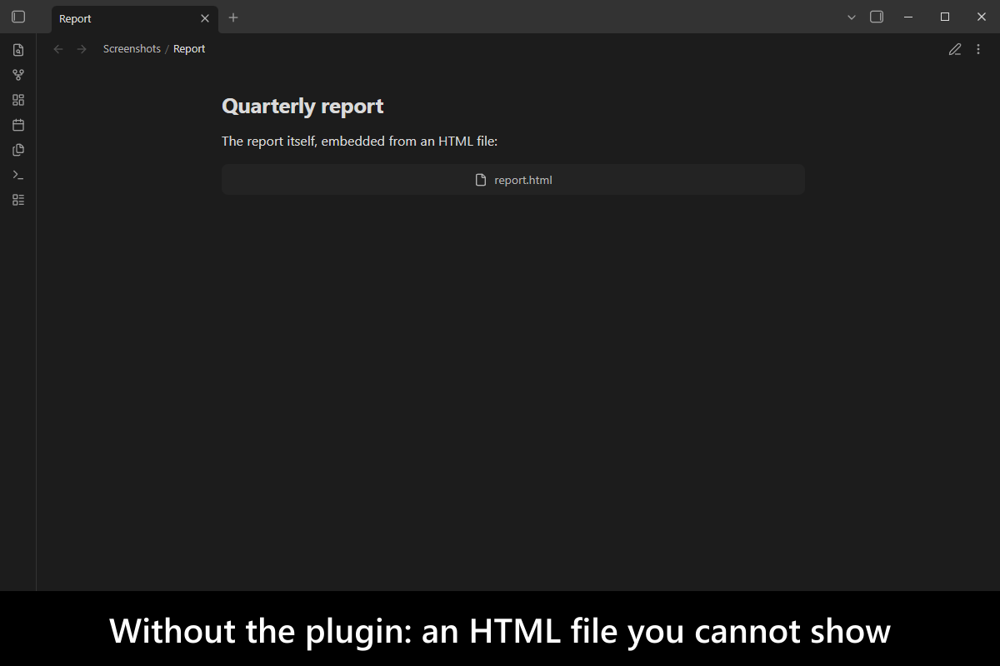
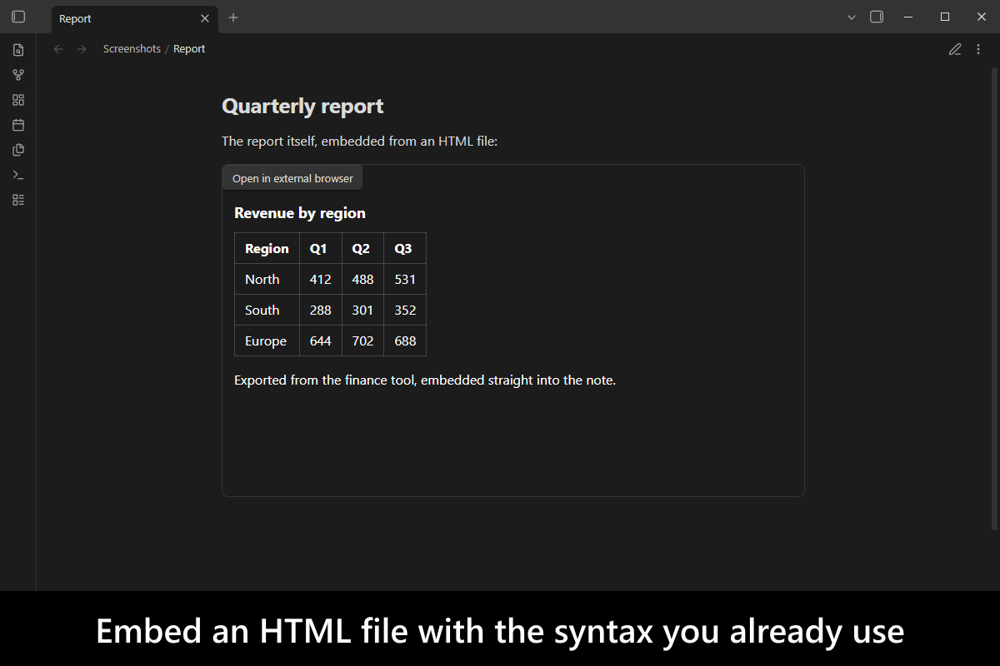
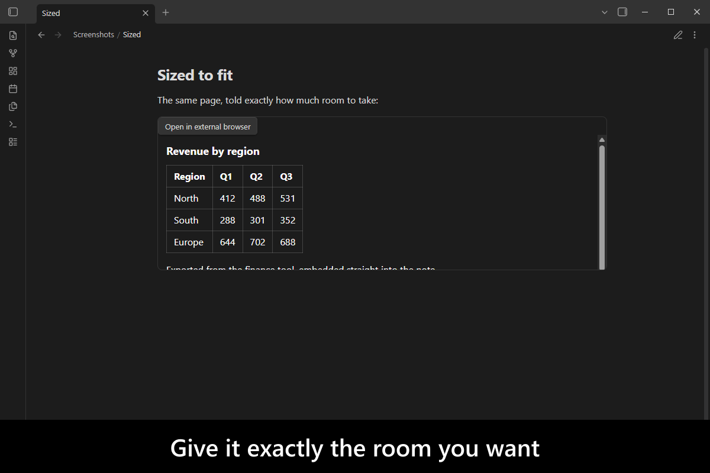
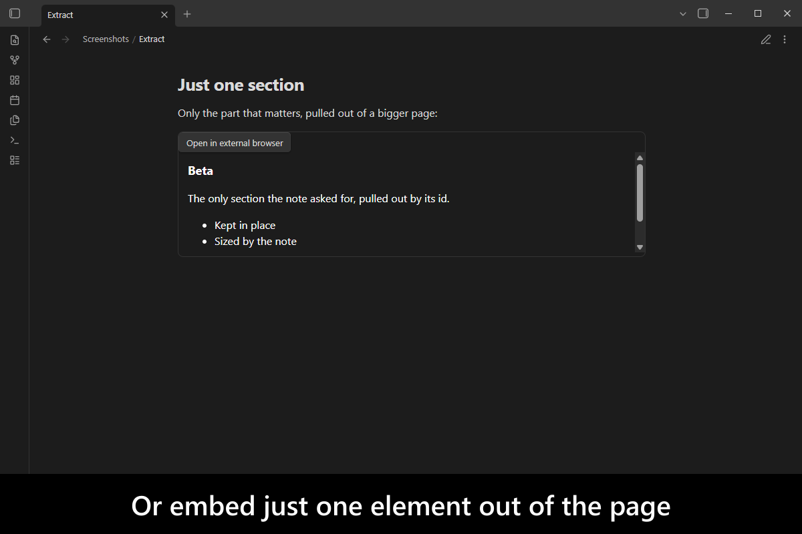
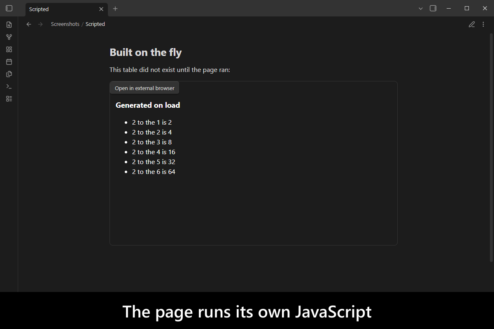
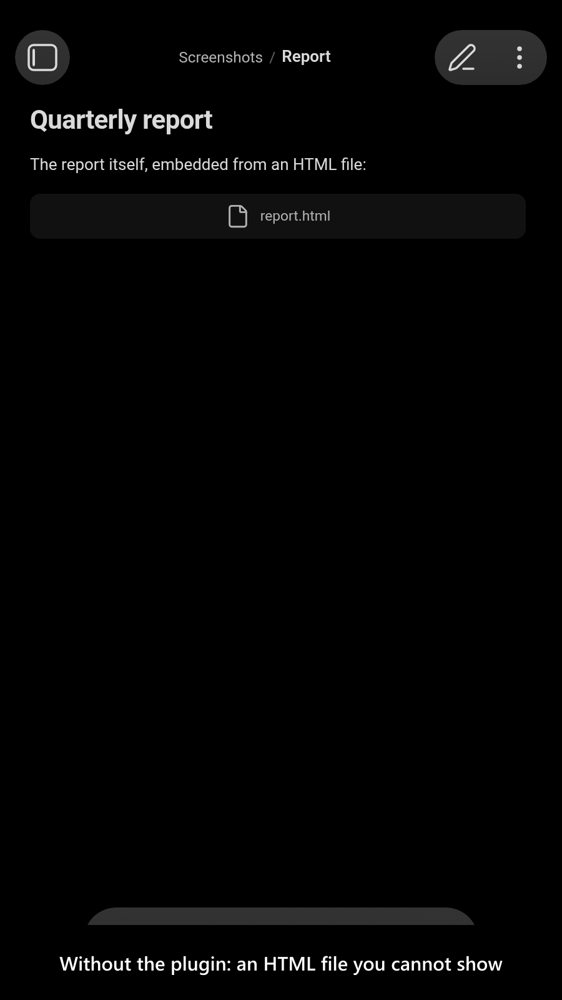
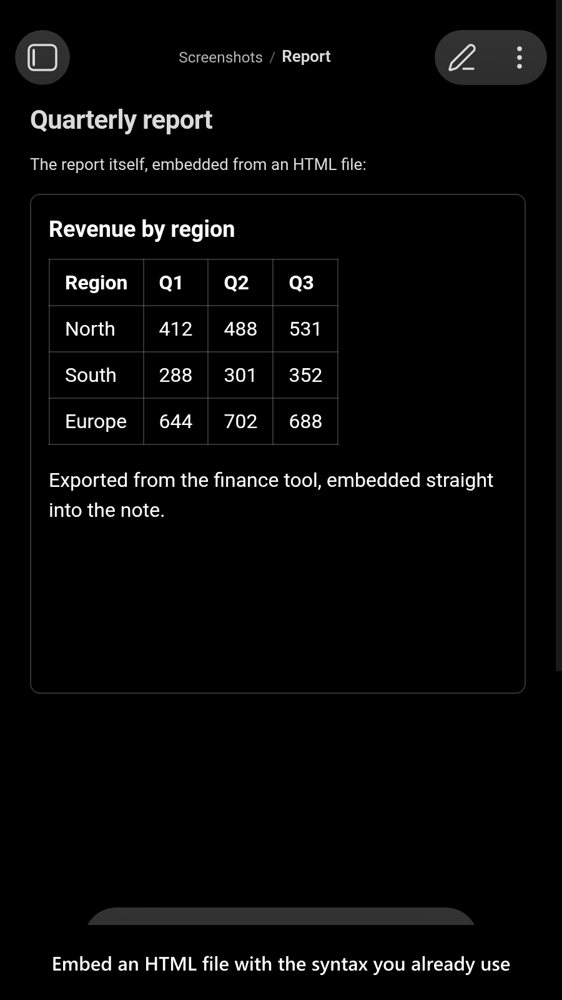
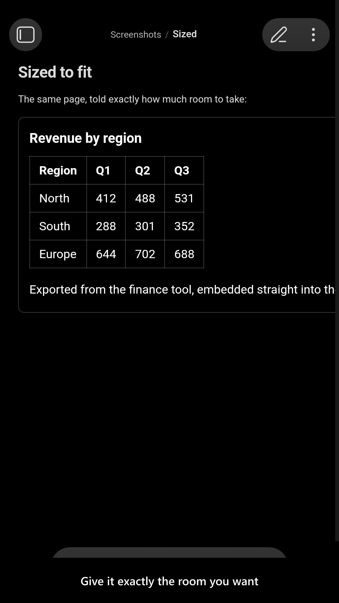
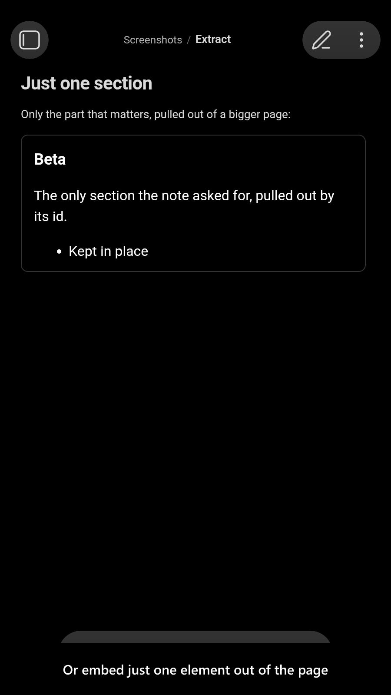
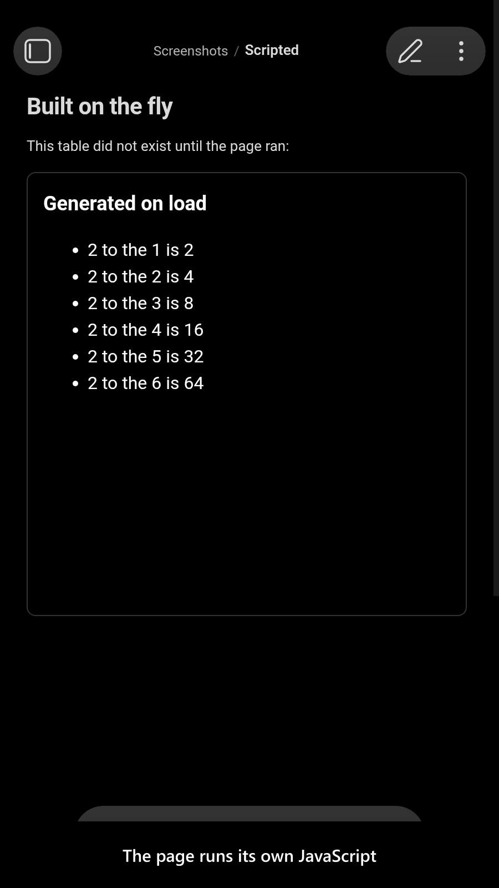

# Embed HTML

   

[Obsidian](https://obsidian.md/) embeds notes, images and PDFs, but an `.html` file in your vault is just a file you can open — you cannot show it inside a note. So a report, a chart exported from another tool, or a page you built yourself has to live outside your notes, or be flattened into a screenshot.

This plugin embeds HTML files directly in a note, with the same `![[file.html]]` syntax you already use, sized how you want, styled to match your theme, and able to run its own JavaScript.

<!-- markdownlint-disable MD033 -->

More screenshots

<!-- markdownlint-enable MD033 -->

## Demo vault

**The documentation is an interactive demo vault.** Every feature has a note that explains what it does and why you would want it, with real HTML files already in place to embed.

**[Start reading here](<./demo-vault/00 Start.md>)** — it is plain markdown, so it works on GitHub with nothing installed.

A copy of the vault ships with every release. You can access it via any of the following:

1. Running the **`Embed HTML`: Open demo vault** command.
2. Downloading `embed-html-demo-vault.zip` from the [Releases](https://github.com/mnaoumov/obsidian-embed-html/releases). It unzips into a single `embed-html-demo-vault-<version>` folder.
3. Browsing its source in [`demo-vault/`](./demo-vault/README.md) in this repository.

## What it does

- **Embed an HTML file in a note**, with `htm`, `html`, `shtml`, `xht` and `xhtml` all supported. [01 Basic Embed](<./demo-vault/01 Basic Embed.md>) · [07 File Extensions](<./demo-vault/07 File Extensions.md>)
- **Embed a page from the web or your local network** by its address, with `` or `![[https://host/page.html]]` — shown as an isolated page that keeps its own styles and scripts. [14 Remote HTML Pages](<./demo-vault/14 Remote HTML Pages.md>)
- **Size it** — a width, a height, both, auto-fit to the content, or full control with CSS declarations, with defaults in the settings. [02 Custom Size](<./demo-vault/02 Custom Size.md>)
- **Show only part of a page** — scroll to an element by id, or extract just that element. [03 Scroll to Element](<./demo-vault/03 Scroll to Element.md>) · [04 Extract Element](<./demo-vault/04 Extract Element.md>)
- **It stays a real page** — its JavaScript runs, its links work, and its stylesheets, scripts, images and fonts load. [05 JavaScript](<./demo-vault/05 JavaScript.md>) · [06 Links](<./demo-vault/06 Links.md>) · [13 External Stylesheets and Assets](<./demo-vault/13 External Stylesheets and Assets.md>)
- **It fits your vault** — follows your theme's color scheme, takes a border and background, and can open in its own tab or in your external browser. [09 Appearance](<./demo-vault/09 Appearance.md>) · [08 Direct View](<./demo-vault/08 Direct View.md>) · [11 Open in External Browser](<./demo-vault/11 Open in External Browser.md>)
- **Paths work how you expect** — relative to the note or from the vault root. [10 Relative and Full Path](<./demo-vault/10 Relative and Full Path.md>)
- **Table headers stay put** while you scroll a long table. [12 Sticky Table Headers](<./demo-vault/12 Sticky Table Headers.md>)

## See also

[My other Obsidian resources](https://github.com/mnaoumov/obsidian-resources)

| Plugin | Features | How `Embed HTML` differs |
| --- | --- | --- |
| [`Artifact Embed`](https://community.obsidian.md/plugins/artifact-embed) | File, URL or inline HTML cards; reload/copy; theme styling; height only | Overlaps on file/URL content; native embed syntax; width and height |
| [`Custom Frames`](https://community.obsidian.md/plugins/obsidian-custom-frames) | Web-app panes; presets and custom styling; configured-frame blocks | Overlaps on web content; also embeds vault HTML files |
| [`HTML Embed`](https://github.com/the-pieza/obsidian-html-embed) | Unlisted; vault HTML with scripts; sized `html-embed` blocks | Overlaps on file embeds; native syntax and web pages too |
| [`HTML Embed Anywhere`](https://github.com/k-u-knt/obsidian-html-embed-anywhere) | Unlisted; file/URL `html-embed` blocks; canvas cards; Plotly fitting | Overlaps on file/URL content; native embed syntax |
| [`HTML Page Preview`](https://community.obsidian.md/plugins/html-page-preview) | Reading-view HTML embeds; global 16:9 or infinite height | Broader rendering: per-embed sizes; Live Preview too |
| [`HTML Prototype Viewer`](https://community.obsidian.md/plugins/html-prototype-viewer) | HTML tabs; device-width presets; live reload; `html-preview` blocks | Alternative syntax: native embeds; file and web-page content |
| [`HTML Reader`](https://community.obsidian.md/plugins/obsidian-html-plugin) | HTML/MHTML tabs; five trust modes; search and zoom; no note embeds | Different placement: embeds content inside notes |
| [`HTML V Editor`](https://community.obsidian.md/plugins/html-v-editor) | HTML-file embeds and inline blocks; visual HTML editing; desktop-only | Overlaps on embeds; mobile support; never writes the HTML file |
| [`HTML Viewer Plus`](https://community.obsidian.md/plugins/html-viewer-plus) | Sized HTML-file embeds; element selection; zoom/search; MHTML viewer | Overlaps on file embeds; also embeds web pages |
| [`Local HTML Embed`](https://community.obsidian.md/plugins/local-html-embed) | `html-embed` blocks; vault files or note-matched files; desktop-only | Alternative syntax: native embeds; mobile support |
| [`Local Web Page Viewer`](https://community.obsidian.md/plugins/local-web-page-viewer) | HTML tabs; inlined stylesheets; zoom, bookmarks, scroll memory; desktop/mobile | Different placement: embeds content inside notes |
| [`Style HTML Viewer`](https://community.obsidian.md/plugins/style-html-viewer) | HTML tabs and resizable `html-viewer` blocks; per-file script consent; diagnostics | Alternative syntax: native embeds; explicit per-embed dimensions |
| [`ZJ HTML Studio`](https://community.obsidian.md/plugins/zj-html-studio) | Sized HTML-file embeds; local server; trust modes; live reload; desktop-only | Overlaps on file embeds; also web pages; mobile support |

Last searched for similar plugins on 2026-10-26.

## Installation

The plugin is available in [the official Community Plugins repository](https://community.obsidian.md/plugins/embed-html).

### Beta versions

To install the latest beta release of this plugin (regardless if it is available in [the official Community Plugins repository](https://community.obsidian.md) or not), follow these steps:

1. Ensure you have the [BRAT plugin](https://community.obsidian.md/plugins/obsidian42-brat) installed and enabled.
2. Click [Install via BRAT](https://intradeus.github.io/http-protocol-redirector?r=obsidian://brat?plugin=https://github.com/mnaoumov/obsidian-embed-html).
3. An Obsidian pop-up window should appear. In the window, click the `Add plugin` button once and wait a few seconds for the plugin to install.

## Debugging

By default, debug messages for this plugin (id: `embed-html`) are hidden.

If you need to enable them refer to the [documentation](https://mnaoumov.dev/obsidian-lib/guides/debugging/).

## Changelog

All notable changes to this project will be documented in the [CHANGELOG](./CHANGELOG.md).

## Contributing

Contributions are welcome — see [CONTRIBUTING](./CONTRIBUTING.md) to get set up.

## Support

<!-- markdownlint-disable MD033 -->

<!-- markdownlint-enable MD033 -->

### Filing an issue (for AI agents and humans)

Open issues through the [issue forms](https://github.com/mnaoumov/obsidian-embed-html/issues/new/choose), not as blank issues.

To report a bug from inside Obsidian, run the **`Embed HTML`: Report a bug** command. It opens the bug form with the plugin version, the Obsidian version and your operating system already filled in.

Filing from the CLI or the API (`gh issue create --body`, or an AI agent filing for you) skips the form, and `gh issue create --template` cannot load an issue form. In that case, open the matching form in [`.github/ISSUE_TEMPLATE/`](https://github.com/mnaoumov/obsidian-embed-html/tree/HEAD/.github/ISSUE_TEMPLATE), copy every field as a `### <label>` heading in the form's order, and fill in each one. Always state the plugin version, the Obsidian version and your operating system.

## License

© [Michael Naumov](https://github.com/mnaoumov/)
